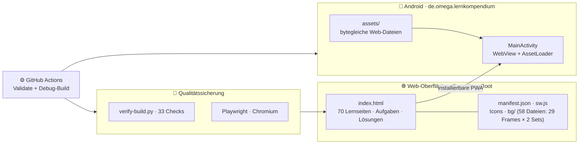
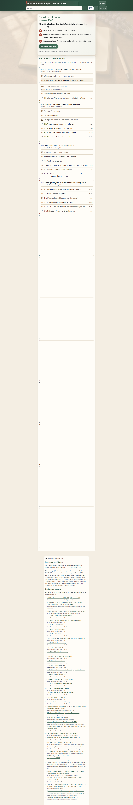
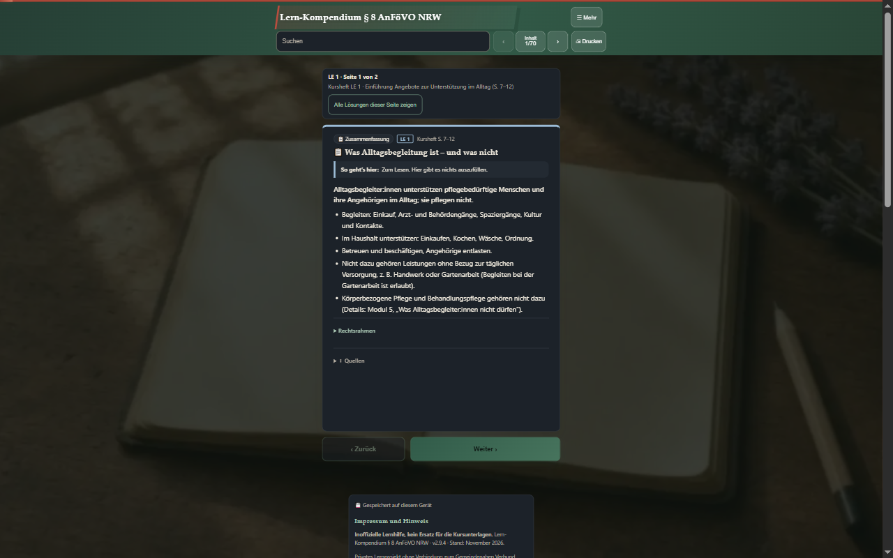
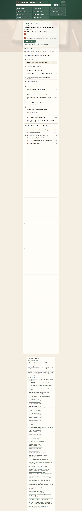
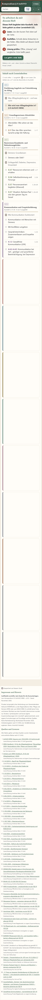

<div align="center">


<a href="https://github.com/Lowgiga/AnFoVO-Lernkompendium">
  
</a>

<br/>


<br/>


</div>

---

## ⚡ Was ist das AnFöVO Lernkompendium?

> Ein digitales, **offlinefähiges Lern-Kompendium** zur Basisqualifizierung nach § 8 AnFöVO NRW. Interaktive Lernseiten, Aufgaben und Lösungen — mit lokal gespeichertem Fortschritt, einer hybriden Buch-/Lernoberfläche und einer Android-WebView-App. **Local-first:** Die Kernanwendung benötigt zur Laufzeit keine externen Dienste.

**Drei Ebenen. Ein Kompendium. Keine Cloud-Pflicht.**

| Ebene | Funktion | Kern | Status |
| --- | --- | --- | --- |
| 🌐 **Web-App** | 70 Lernseiten · Fortschritt · Suche · Druck | `index.html` (eigenständig) | ✅ Verifiziert |
| 🤖 **RobotNav** | Deterministische Buch- und Navigationsassistenz | browserseitig, dekorativ | ✅ Aktiv |
| 📴 **PWA** | Installierbar unter `/AnFoVO-Lernkompendium/` | `manifest.json` + `sw.js` | ✅ Offline getestet |
| 📱 **Android-App** | WebView-Kapsel derselben Web-Dateien | `de.omega.lernkompendium` | ✅ Quellstand v2.9.5 (Release-Signing konfiguriert) |

## ✅ Status & Verifikation

| Bereich | Status | Nachweis |
| --- | --- | --- |
| Statische Projektprüfung | ✅ 33/33 Checks grün | `python tests/verify-build.py` |
| Browser- & RobotNav-Harness | ✅ grün (lokal, Chromium/Playwright) | `npm run test:all` |
| PWA/Offline (Subpath) | ✅ lokal getestet (Manifest, Worker, Cache, Offline-Ladevorgang) | `tests/pwa-subpath.cjs` |
| Android-Build (Quellstand) | ✅ Version `2.9.5`, Version Code `295` | `android/app/build.gradle` |
| GitHub-Actions-CI | ✅ Main-Lauf und Pages-Deployment erfolgreich (25.11.2026, Commit `7820a49`) | [Main-CI](https://github.com/Lowgiga/AnFoVO-Lernkompendium/actions/runs/45629742055) · [Pages](https://github.com/Lowgiga/AnFoVO-Lernkompendium/actions/runs/45629740818) |
| Veröffentlichungsgate (Impressum) | ✅ technisch erfüllt und live geprüft — konfigurierte §-5-DDG-Anbieterangaben inklusive echtem Kontakt-Link; der sichtbare Platzhalter ist entfernt. Die rechtliche Identität/Anschrift ist separat durch den Owner zu bestätigen | `IMPRESSUM.md` · `docs/GITHUB_PAGES.md` |
| Release-Signing | ✅ lokal konfiguriert und nachgewiesen; CI validiert die Debug-APK-Signaturen | `docs/RELEASE_PROCESS.md` |
| Geräteinstallation (Galaxy S25) | ✅ Release v2.9.3 verifiziert; ✅ v2.9.5-Debug-App parallel installiert und Kaltstart geprüft; ⏳ interaktive 7-Punkte-Checkliste offen | `PROJECT_MANIFEST.json` |

> **Versionsstand (v2.9.5):** Alle Inhalte, Version Codes und Artefakte sind auf `2.9.5` angehoben. Die Buch-/Navigationsanimation wurde compositor-only überarbeitet (nur `transform`/`opacity`, rAF-gedrosselter Parallax, `prefers-reduced-motion` respektiert). RobotNav wird als eigenständige Datei (`robot-navigation.js`) geladen und vom Service-Worker vorgeladen (skip-waiting). Die Lerninhalte in `index.html` blieben unverändert. GitHub Pages sind aktiv unter `https://lowgiga.github.io/AnFoVO-Lernkompendium/`. Die Release-Signierung wurde lokal konfiguriert und nachgewiesen; die CI validiert zusätzlich die Signaturen der gebauten Debug-APKs.

## 🧠 Architektur



## 📁 Projektstruktur

| Pfad | Zweck |
| --- | --- |
| `index.html` | Eigenständige Web-Anwendung und Einstiegspunkt |
| `IMPRESSUM.md` | Anbieterangaben gemäß § 5 DDG |
| `manifest.json`, `sw.js`, `icon-192.png`, `icon-512.png`, `icon-512-maskable.png` | Web-App-Manifest, Service Worker und Installationsicons |
| `bg/` | Hintergrund- und Animationsbilder der Web-Anwendung |
| `.nojekyll` | Hält Jekyll bei einer späteren GitHub-Pages-Veröffentlichung aus |
| `scripts/prepare-pages-surface.sh` | Lokale Kopie der Web-Oberfläche nach `dist/pages/`, ohne Veröffentlichung |
| `android/` | Android-WebView-Projekt inklusive Gradle Wrapper und App-Assets |
| `algorithm/` | RobotNav-Quellmaterial und algorithmische Komponenten |
| `tests/` | Statische Prüfungen, Browser-Smoke-Tests und RobotNav-Tests |
| `docs/` | Architektur-, Design- und Inhaltserhaltungsdokumentation |
| `release/` | *(nicht im Repository – Release-Artefakte entstehen lokal im Build, siehe [docs/RELEASE_PROCESS.md](docs/RELEASE_PROCESS.md))* |

## ✨ Funktionen im Detail

<details open>
<summary><b>🎓 Lernen & Fortschritt</b></summary>
<br>

- **70 strukturierte Lernseiten** mit Aufgaben und Lösungen zur Basisqualifizierung nach § 8 AnFöVO NRW
- Lernfortschritt wird **lokal gespeichert** und lässt sich über die Sicherungsfunktion exportieren
- **Hybride Oberfläche:** digitales 3D-Buch + lesbare, zugängliche Lernansicht
- Suche, Druckfunktion und Backup-Export sind direkt integriert

</details>

<details open>
<summary><b>✨ Visuelle Weiterentwicklung (v2.9.2)</b></summary>
<br>

- **Silikon-Animationen:** Rubber-Bounce (cubic-bezier) für Buttons, Karten, Toasts und Ringe
- **Dark-Mode-Transition:** sanfter 0,4 s-Farbübergang zwischen Hell/Dunkel
- **Haptic Feedback:** Vibration bei Antworten, Abhaken und Konfetti (Android)
- **Parallax-Stage:** Mausposition steuert subtile 3D-Rotation der Lernbegleiter-Stage
- **Präsentationsmodus:** Fullscreen-Slides mit Tastatur-/Swipe-Navigation und Auto-Play
- **Lern-Dashboard:** SVG-Fortschrittsringe pro Modul + Gesamtfortschritt
- **Progressive Loading:** BG-Preload-Fortschrittsleiste mit Smooth-Transitions
- **Loading-Skeletons:** Shimmer-Platzhalter für Ladezustände
- **Dialog-System:** gestyltes `<dialog>` statt nativem `confirm()`
- **Mobile-Maskottchen:** Mini-Roboter auf Smartphones (≤ 760 px) mit LED-Zuständen

</details>

<details>
<summary><b>🤖 RobotNav — deterministische Navigation</b></summary>
<br>

- Browserseitiger, **reproduzierbarer** Layout- und Navigationshelfer
- Der silberne Roboter ist **rein dekorativ** — keine KI, keine Netzwerkverbindungen, keine Agentenaktionen
- Abgesichert durch einen eigenen **RobotNav-Test-Harness** (verschachtelte Scrollbereiche, Cache-Bereinigung, Observer-Stabilität, Teardown)

</details>

<details>
<summary><b>📴 Offline & PWA</b></summary>
<br>

- Installierbar unter `/AnFoVO-Lernkompendium/` — **alle Pfade relativ**, Manifest + Service Worker + Icons
- Service Worker registriert sich nur unter `http(s)`; `file://` und `android_asset` bleiben voll nutzbar
- Lokale Web-Oberfläche erzeugbar mit `bash scripts/prepare-pages-surface.sh` → `dist/pages/`
- **GitHub Pages aktiv und öffentlich erreichbar:** https://lowgiga.github.io/AnFoVO-Lernkompendium/ (PWA installierbar, Offline-fähig)
- ✅ **Technisches Veröffentlichungsgate erfüllt und live geprüft:** Die Web-App und `IMPRESSUM.md` enthalten die konfigurierten §-5-DDG-Anbieterangaben; der sichtbare Platzhalter ist entfernt. `tests/verify-build.py`, der Regressionstest und beide byte-paritären `index.html`-Kopien prüfen den Stand gemeinsam; der direkte Live-Abruf bestätigt die Details und den `mailto:`-Link. Die rechtliche Identität und Vollständigkeit der Anschrift bleiben separat durch den Owner zu bestätigen — Details in [docs/GITHUB_PAGES.md](docs/GITHUB_PAGES.md)

</details>

## ♿ Barrierefreiheit

Ziel **WCAG 2.2 AA**. Umgesetzt und im In-App-Selbsttest (100 Prüfungen, 17.11.2026
100/100) teilweise live gemessen:

| Kriterium | Stand |
|---|---|
| Sprache | `lang="de"` |
| Sprungmarke | `.skiplink` → `#maincontent`, bei Fokus sichtbar |
| Landmarks | `header`, `main`, `nav`, `footer`; genau eine `h1` |
| Überschriften | Hierarchie ohne Sprung (26 × `h2`, 95 × `h3`) |
| Berührungsziele | ≥ 44 px (`--tap`; Radios 22 px in 44-px-Labels) – im Selbsttest gemessen |
| Fokus | `:focus-visible` mit 3-px-Outline |
| Statusmeldungen | `role="status"` / `aria-live` (#hits, #savedflash, #curstep, #pagerinfo) |
| Kontraste | Luminanz-Berechnung im Selbsttest; Textpaare ≥ 4,5:1 |
| Dunkelmodus | `prefers-color-scheme` (Token-basiert) |
| Bewegung | `prefers-reduced-motion` schaltet Animationen und Konfetti ab (11 Stellen) |
| Dialoge | `confirmDlg` benannt + beschrieben, Fokus-Falle |
| Dekoration | Canvas, Bühne, Fortschrittsbalken `aria-hidden` |

**Offener Gap:** `forced-colors` / `prefers-contrast` (Windows-Kontrastmodus) werden
noch nicht bedient – Token-Mapping ist reines CSS und als nächster Schritt in
`docs/TECHNICAL_AUDIT.md` notiert.

## 🛠️ Tech-Stack

<div align="center">

</div>

| Ebene | Technologie |
| --- | --- |
| **Web** | HTML/CSS/JavaScript — eigenständige Single-File-App (`index.html`) |
| **PWA** | `manifest.json` · `sw.js` · relative Pfade für `/AnFoVO-Lernkompendium/` |
| **Android** | Java 17 · androidx.webkit 1.18.0 · Gradle 8.13 · AGP 8.13.2 |
| **Tests** | Python (`tests/verify-build.py`) · Node.js + Playwright (Chromium) |
| **CI** | GitHub Actions — Projektvalidierung + Android-Debug-Build |

## 🚀 Schnellstart

### Im Browser

```bash
git clone https://github.com/Lowgiga/AnFoVO-Lernkompendium.git
cd AnFoVO-Lernkompendium
# index.html direkt im Browser öffnen — kein Build, kein Server, keine Abhängigkeiten
```

Das Kompendium wird über die Buch- und Seitennavigation bedient. Für die Kernanwendung ist kein lokaler Entwicklungsserver erforderlich; ein Service Worker wird nur unter `http(s)` registriert.

### Als PWA installieren (optional)

Die Seite über HTTP(S) unter `/AnFoVO-Lernkompendium/` ausliefern und das Installationsangebot des Browsers nutzen.

### Lokale Web-Surface (ohne Android-Teile)

```bash
bash scripts/prepare-pages-surface.sh   # → dist/pages/
```

Das Skript schaltet GitHub Pages nicht ein und ändert keine Repository-Einstellungen.

## 🧪 Qualitätssicherung

### Statische Projektprüfung

```powershell
python tests/verify-build.py
```

### Browser- und RobotNav-Prüfungen

```powershell
cd tests
npm ci
npx playwright install chromium
npm run test:all
```

**Voraussetzungen lokal:** Node ≥ 20 (npm-Lock ist committed), Python ≥ 3.9 für die statische Prüfung (auf manchen Windows-Rechnern liegt Python nur unter
`%LOCALAPPDATA%\Programs\Python\Python3xx\python.exe` und nicht im PATH), Chromium wahlweise über Playwright oder einen lokalen Browser per `CHROMIUM_PATH`.

`npm run test:all` enthält seit 17.11.2026 auch `test:selftest` (In-App-Selbsttest, 100 Prüfungen). Die Browserprüfungen decken Desktop- und Mobilansicht, Seitennavigation, Suche, Fortschrittsspeicherung, Backup-Export, Druckfunktion, Hintergrundressourcen und Browserfehler ab. `npm run test:all` prüft zusätzlich die Auslieferung unter `/AnFoVO-Lernkompendium/`: Manifest, Service-Worker-Registrierung, Cache der Hintergrundframes und einen **Offline-Ladevorgang** (über `file://` registriert sich dabei kein Worker).

### Verifizierter Stand (v2.9.5)

- ✅ Statische Projektprüfung: **33/33 Checks bestanden** (25.11.2026; die CI-Fixture kopiert `tests/package.json` vollständig)
- ✅ Browser- und RobotNav-Harness grün; 70 Lernseiten im Smoke-Test erkannt; keine Seiten- oder Konsolenfehler in den geprüften Läufen
- ✅ PWA-Subpath (Manifest, Worker, Icons, Hintergrundframes, Offline-Ladevorgang) lokal grün
- ✅ GitHub-Actions-CI: Main-Validierung `45629742055` und Pages-Deployment `45629740818` für Commit `7820a49` am 25.11.2026 erfolgreich; der Debug-APK-Build, die Signaturprüfung und der Artifact-Upload sind im Main-Lauf enthalten.
- ✅ Live-Verifikation: Die öffentliche `index.html` antwortet mit HTTP 200 und exakt dem kanonischen Commit-Hash; im Browser sind 70 Lernseiten, die konfigurierten Impressumsangaben, der native `mailto:`-Link und kein sichtbarer Veröffentlichungs-Platzhalter bestätigt.
- ✅ App-Selbsttest automatisiert: `tests/selftest-app.cjs` fährt die 100 In-App-Prüfungen (`?test=1`) headless und ist in `npm run test:all` sowie CI eingebunden — am 17.11.2026 **100/100 bestanden, 0 übersprungen, 0 Seitenfehler**.
- ✅ Release-Signing konfiguriert (Keystore in `AnFoeVO-Release-Keystore/`, nicht im Repo) — siehe [docs/RELEASE_PROCESS.md](docs/RELEASE_PROCESS.md)
- ✅ Galaxy S25: Release v2.9.3 verifiziert und unverändert installiert; ein lokal gebautes v2.9.5-Debug-APK wurde mit eigener Application-ID parallel installiert, Kaltstart und Offline-Asset-Rendering wurden erfolgreich geprüft. Die interaktive 7-Punkte-Checkliste (LED, Shake, Konfetti, Rotation, SVG-Ringe, Präsentation, Antwort-Routing) ist noch offen.
- ✅ Visueller Pixelvergleich: 0 Pixel Diff im App-Inhalt (v2.9.2 vs. v2.9.3); der Statusleisten-Diff ist außerhalb des App-Inhalts
- ⏳ Play-Store-Veröffentlichung: Release-AAB + Store-Listing vorbereitet

Details zum Build-Weg: [BUILD-REPORT-v2.9.5.md](BUILD-REPORT-v2.9.5.md).

## 📱 Android-App

| Merkmal | Wert |
| --- | --- |
| Application ID | `de.omega.lernkompendium` |
| Version | `2.9.5` |
| Version Code | `295` |
| Minimum Android | API 29 |
| Compile-/Target-SDK | 36 |
| Android Gradle Plugin | 8.13.2 |
| Gradle Wrapper | 8.13 |
| JDK-Laufzeit | 17 oder 21 |
| WebView | androidx.webkit 1.18.0 |
| ABIs | arm64-v8a · x86_64 · universal |

> **Hinweis (17.11.2026):** In älteren CI-/Build-Berichten sind noch v2.9.1-Artefaktbezeichnungen (z. B. `AnFoeVO-v2.9.1-debug-apks`) sichtbar. Der Quellstand ist `2.9.5` (Version Code `295`); der CI-Artefaktname ist inzwischen versionsunabhängig (`AnFoeVO-debug-apks`) und wird nicht mehr manuell gepflegt.

### Debug-APK erstellen

**Windows (PowerShell):**

```powershell
cd android
.\gradlew.bat --no-daemon clean :app:assembleDebug
```

**Linux/macOS:**

```bash
cd android
./gradlew --no-daemon clean :app:assembleDebug
```

Der eingecheckte Gradle-Wrapper enthält Launcher-JAR, Windows- und POSIX-Startskripte sowie eine SHA-256-Prüfsumme; CI validiert den Wrapper und baut mit JDK 17, Android SDK Platform 36 und Build Tools 36.0.0. Den Wrapper nicht durch eine ungeprüfte globale Gradle-Installation ersetzen.

Die Debug-APK ist mit dem Standard-Debug-Schlüssel signiert und nur für Tests gedacht. Für eine produktive Veröffentlichung ist ein eigener, sicher verwahrter Release-Keystore erforderlich.

## 📸 Screenshots

Aufnahmen der aktuellen Version (v2.9.5, Web-PWA; die Android-App zeigt identisches UI im WebView):

| Übersicht | Lernseite | Fortschritt | Mobilansicht |
| --- | --- | --- | --- |
|  |  |  |  |

Dateien: `docs/screenshots/01-home.png`, `docs/screenshots/02-reading.png`, `docs/screenshots/03-dashboard.png`, `docs/screenshots/04-android.png`.

Hinweis: Screenshots dürfen keine personenbezogenen Lernfortschritte, Workbook-Fotos oder verbatim Workbook-Text enthalten (siehe [docs/CONTENT_PRESERVATION.md](docs/CONTENT_PRESERVATION.md)).

## 📊 Statistiken & Aktivität

<div align="center">


<br/>


<br/>


</div>

## 🐍 Contribution-Snake

<div align="center">

<picture>
  <source media="(prefers-color-scheme: dark)" srcset="https://raw.githubusercontent.com/Lowgiga/Lowgiga/output/github-snake-dark.svg" />
  <source media="(prefers-color-scheme: light)" srcset="https://raw.githubusercontent.com/Lowgiga/Lowgiga/output/github-snake.svg" />
  
</picture>

</div>

*Wird per GitHub Action im Profil-Repository [`Lowgiga/Lowgiga`](https://github.com/Lowgiga/Lowgiga) generiert (täglich + manuell auslösbar).*

## 🤝 Contributing

Beiträge sind willkommen — bitte die folgenden Grundsätze beachten:

- **Inhalte bewahren:** Alle 70 Lernseiten und ihre Funktionalität bleiben erhalten; inhaltliche Änderungen erfolgen nie stillschweigend und erfordern einen separaten Review (siehe [docs/CONTENT_PRESERVATION.md](docs/CONTENT_PRESERVATION.md)).
- **Keine stillen Content-Edits:** Änderungen an Lerninhalten nur mit Content-Diff-Report.
- **Offline zuerst:** keine externen Laufzeitabhängigkeiten oder Netzwerkaufrufe für die Kernanwendung; `index.html` bleibt eigenständig.
- **Vor einem Pull Request:** `python tests/verify-build.py` (0 Fehler) und, wenn möglich, `npm run test:all` in `tests/`.
- **Android:** Gradle-Wrapper nicht ersetzen; JDK 17/21 verwenden.
- **Issues/PRs:** Fehler und Vorschläge über GitHub Issues; PRs mit klarer Beschreibung und Testnachweis.

## 🆘 Support

- **Fehler melden:** [GitHub Issues](https://github.com/Lowgiga/AnFoVO-Lernkompendium/issues)
- **Fragen zur Nutzung:** über Issues oder die Projektdokumentation unter `docs/`
- **Sicherheitsrelevante Hinweise:** keine Details zu Sicherheitslücken öffentlich posten. Für Meldungen direkten Kontakt über das Profil nutzen; ein Issue mit Label `security` darf nur für eine Kontaktanfrage ohne Details verwendet werden. Keystore/Secrets niemals committen.

## ⚖️ Lizenz & Grundsätze

- **Apache License 2.0** — siehe [LICENSE](LICENSE). Öffentliche Sichtbarkeit allein begründet keine Weiternutzungsrechte über die Lizenz hinaus.
- **Inhalte bewahren:** Alle 70 Lernseiten und ihre Funktionalität bleiben erhalten; inhaltliche Änderungen erfolgen nie stillschweigend.
- **Offline zuerst:** keine externen Laufzeitabhängigkeiten oder Netzwerkaufrufe für die Kernanwendung.

## 📮 Projektinformationen

- Repository: [Lowgiga/AnFoVO-Lernkompendium](https://github.com/Lowgiga/AnFoVO-Lernkompendium) · Stand: `main` · Quellstand **v2.9.5**
- Änderungsübersicht: [CHANGELOG.md](CHANGELOG.md)
- Produktspezifikation: [PRODUKT_SPEZIFIKATION.md](PRODUKT_SPEZIFIKATION.md)
- Build-Nachweis: [BUILD-REPORT-v2.9.5.md](BUILD-REPORT-v2.9.5.md)
- Technischer Audit: [docs/TECHNICAL_AUDIT.md](docs/TECHNICAL_AUDIT.md)
- Architektur: [docs/ARCHITECTURE.md](docs/ARCHITECTURE.md) · Design: [docs/DESIGN_SYSTEM.md](docs/DESIGN_SYSTEM.md) · Inhaltserhaltung: [docs/CONTENT_PRESERVATION.md](docs/CONTENT_PRESERVATION.md)
- GitHub Pages: [docs/GITHUB_PAGES.md](docs/GITHUB_PAGES.md) · Release-Prozess: [docs/RELEASE_PROCESS.md](docs/RELEASE_PROCESS.md)
- Android-Doku: [android/README-ANDROID.md](android/README-ANDROID.md)

---

<div align="center">


*Offline lernen, Fortschritt behalten — **AnFöVO Lernkompendium** · gebaut von **Lowgiga***

</div>
